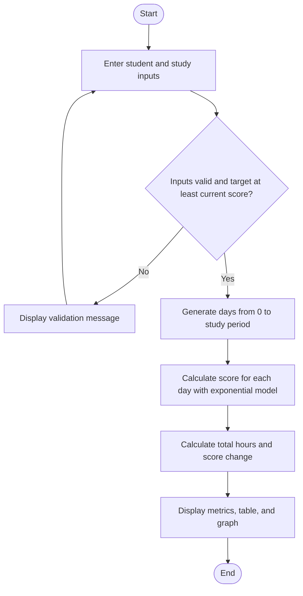

# Student Performance and Study-Time Predictor Using Exponential Growth Model

## Abstract

This project demonstrates the use of an exponential model in a practical educational scenario. A Streamlit application accepts a student's current score, a target score, daily study hours, a study period, and an improvement constant. NumPy calculates the modelled score for each day, while the application presents the result as summary metrics, a table, and a Matplotlib graph. The model is an instructional simulation and should not be interpreted as a scientifically validated forecast of examination performance.

## Introduction

Exponential functions describe processes where a quantity changes at a rate proportional to its current amount or its distance from a limiting value. In this project, the remaining difference between a score and a chosen target decreases exponentially over time. This gives students a concrete way to explore parameters, evaluate a mathematical model, and connect an equation with a visual representation.

## Problem Statement

Students need a straightforward way to observe how a selected mathematical growth model changes an initial score across a defined study period. A manual calculation for every day is repetitive and makes it harder to compare the overall trend. This project automates the calculations and presents them in a compact, interactive dashboard.

## Objectives

- Implement the given exponential score model in Python.
- Let a user enter the student and study-plan values.
- Validate score inputs and require the target to be at least the initial score.
- Calculate and display a modelled score for every day in the period.
- Summarize planned study hours and score changes.
- Present the results in a readable table and labelled graph.

## Mathematical Background

The model is

\[
\mathrm{Score}(t) = S_{\max} - (S_{\max} - S_0)e^{-kt}
\]

where:

- `S0` is the student's initial score percentage.
- `Smax` is the assumed target score percentage, with `S0 <= Smax <= 100`.
- `k` is a positive, user-configurable improvement constant.
- `t` is elapsed study time in days, where `t >= 0`.

The remaining gap is `Smax - Score(t) = (Smax - S0)e^(-kt)`. It decays exponentially as time increases, so the modelled score approaches `Smax`. At `t = 0`, the model returns `S0`. If `Smax = S0`, the initial gap is zero and the model returns the same score at every time. A larger `k` causes the gap to close more quickly. The equation does not include daily study hours; in this application, daily hours are used only to calculate total planned study time.

## Algorithm

1. Read the student name and study inputs.
2. Check that the name is not blank, scores are within 0 to 100, the target is not below the current score, the study period is positive, daily hours are within 0 to 24, and `k` is positive.
3. Create the integer day values from day 0 through the final study day.
4. For each day, evaluate the exponential model using NumPy.
5. Calculate the total planned study hours as daily hours multiplied by the number of study days.
6. Display the student details, metrics, daily score table, and score-versus-days graph.

## Flowchart

## Implementation Details

The application is implemented in `app.py`:

- **Streamlit** collects the inputs and arranges the dashboard.
- **NumPy** builds the day values and evaluates the model.
- **Pandas** formats the daily results as a table.
- **Matplotlib** draws the modelled-score line and target reference line.

The `calculate_scores` function checks its score and `k` values and rejects negative study days. The interface also validates the student name and ensures the target score is not below the initial score. If both scores are equal, the formula's zero initial gap yields a constant line without a special approximation or division.

To run the project on Windows, create and activate a virtual environment, install the packages in `requirements.txt`, and start the app with `python -m streamlit run app.py`. See `README.md` for the exact commands.

## Sample Results

For a student named Alex Morgan with an initial score of 58%, target of 90%, daily study time of 2.5 hours, study period of 30 days, and `k = 0.08`:

- Total planned study time: `2.5 * 30 = 75.0 hours`.
- Initial score at day 0: `58.00%`.
- Modelled score at day 30: `90 - (90 - 58)e^(-0.08 * 30)`, approximately `87.10%`.
- Modelled increase: approximately `29.10 percentage points`.

Selected daily values, rounded to two decimal places:

| Study day | Modelled score (%) |
| ---: | ---: |
| 0 | 58.00 |
| 10 | 75.62 |
| 20 | 83.54 |
| 30 | 87.10 |

## Limitations

- The model is a simplified mathematical illustration, not an empirically validated predictor.
- Real academic progress is affected by many factors not represented by this equation, including prior knowledge, learning methods, health, instruction, and assessment difficulty.
- The model approaches but generally does not reach its target in a finite time.
- Daily study hours affect only the planned-hours metric and are not an input to the specified score equation.
- The assumed target is user-selected; it is not inferred from student data.

## Conclusion

The project implements and visualizes an exponential gap-decay model with configurable inputs. It demonstrates the relationship between the initial score, target, improvement constant, and time, while using validation to enforce meaningful score values. The daily table and graph make the model's approach toward the target easy to inspect. Its output is suitable for learning and demonstration, not for making actual examination predictions.

## References

1. Streamlit, “Streamlit documentation,” https://docs.streamlit.io/ (accessed 18 October 2026).
2. NumPy, “NumPy documentation,” https://numpy.org/doc/ (accessed 18 October 2026).
3. Matplotlib, “Matplotlib documentation,” https://matplotlib.org/stable/ (accessed 18 October 2026).
4. OpenStax, *Algebra and Trigonometry 2e*, section on exponential functions, https://openstax.org/details/books/algebra-and-trigonometry-2e (accessed 18 October 2026).